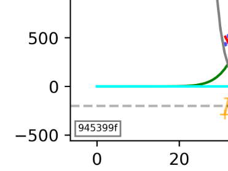
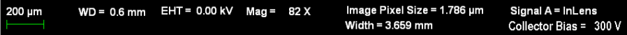

# Why do I want to sneaky-plot-tag?

reproduciblity! It's important - or so I'm told. But - it takes discipline.

What code made this plot?

Maybe you see some weird glitch in the output of an analysis, and you message a snapshot to someone else to remark on it or you copy it into your lab notebook. You committed the code that generated it, but then over time that code was scrapped and altered and improved on and that specific analysis gets buried in the git repo. Oh, and the filename got obliterated to `download (57).jpg`, so there's no tracing that.

Some possible strategies:

- Use a reproducibility tool like [sacred](https://github.com/IDSIA/sacred) or [Sumatra](https://github.com/open-research/sumatra).
- Have so much descriptive metadata in the plot title itself (data input source manifest, processing pipeline description, etc) that reconstructing the plot is trivial.
- Turn every plot into an artifact. Pack up a Release in your git forge (or have your organization host some kind of Handle server) before sharing anything. Ensure that your plots always contain the identifier to the Release (this should be globally automatic, since you might forget to add this to the title) or only share embed links.
    A practical advice I've read is to treat data science pipelines like production software; using the same tools to formally "cut a release", using established CI/CD techniques to package the outputs and the code together and store them in a central, hosted location, as if the plots were a compiled binary.
- Just... don't do this. Ensure that the code that generated each plot at every remarkable stage of development is kept easily discoverable.

---

This package is just a little nudge towards this direction:

an unobtrusive little tag with the git short-hash is added in the corner of plots. I've found this to work pretty great - git forges typically allow you to do searches by short hash - even if you don't know the right repo.

Inspired by the section (which some call the `Data Zone`) that most electron microscope vendors bake into their micrographs.

presumably this is useful in case someone finds a printout of Shectman's 5-fold diffraction pattern on the floor, devoid of any context.

It's nice to have metadata and provenance available to a script, but I haven't yet learned how to attach this meaningfully to a plot.
